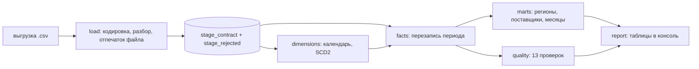

# zakupki-dwh — хранилище закупок: слои, «звезда» и проверки качества

Выгрузка о государственных закупках приходит файлом: суммы с пробелами и запятой, даты в двух форматах, пустые ИНН, дубли строк, а через неделю тот же файл присылают ещё раз — уже исправленный. Проект превращает такие файлы в хранилище, по которому можно считать: сколько сэкономлено по регионам, кто главные поставщики, какая доля закупок ушла единственному поставщику.

Три слоя: `stage` — как пришло, `core` — «звезда» с историей измерений, `mart` — готовые витрины. Одна зависимость (DuckDB), один файл хранилища, ни одного облачного сервиса.

```text
$ zakupki demo

Выгрузка: 452 строк в файле выгрузка.csv (кодировка Windows-1251).
Партия №1: строк 452, принято 415, отброшено 23, повторов в файле 14.
Файл «выгрузка.csv» уже загружен партией №1 — пропускаю.
Партия №2: строк 452, принято 415, отброшено 23, повторов в файле 14.

Измерения: поставщиков — новых 10, с новой версией 1; заказчиков — новых 8, с новой версией 5.
Факт собран за всё время: строк 415, перезаписано 0.
Витрины: mart_region — 7 строк, mart_supplier — 10 строк, mart_month — 8 строк.

Хранилище: строк в stage 830, в факте 415, сумма контрактов 1 807 799 080 ₽.

Качество:
+ факт не пуст: строк в факте 415
+ ключи измерений подставлены: у всех строк есть заказчик и поставщик
+ реестровый номер уникален: реестровых номеров 415 из 415
+ строк столько же, сколько в stage: в факте 415, в stage 415
+ суммы сходятся со stage: факт 1 807 799 080.00, stage 1 807 799 080.00
! регионы есть в справочнике: неизвестные коды: 99
+ даты есть в календаре: календарь покрывает все даты
+ история поставщиков непротиворечива: интервалы не пересекаются, текущая версия одна
+ история заказчиков непротиворечива: интервалы не пересекаются, текущая версия одна
· цена не выше начальной: контрактов дороже начальной цены: 7
+ заявки указаны: везде хотя бы одна заявка
+ данные свежие: последний контракт 12.08.2026, это 31 дн. назад
· выгрузка разобрана целиком: строк не разобрано: 46

Не пройдено проверок: 3 из 13.

История поставщика, сменившего название:
Роль       Наименование        Действует с  По           Текущая
поставщик  ООО «Ромашка»       15.01.2026   20.05.2026   нет
поставщик  ООО «Ромашка Плюс»  20.05.2026   по сей день  да
```

Три строчки в этом выводе — весь смысл проекта. Повторная загрузка того же файла не добавила ни строки. Исправленная выгрузка перекрыла прежнюю версию контракта, а не удвоила сумму: в `stage` 830 строк, а в факте по-прежнему 415. А поставщик, сменивший название в мае, получил вторую версию строки измерения — январские контракты остались за «Ромашкой», майские ушли к «Ромашке Плюс».

## Что внутри

| Слой | Что лежит | Зачем |
|---|---|---|
| `stage_contract` | разобранные строки выгрузки с номером партии | видно, что именно пришло и когда; исправленная выгрузка ложится рядом, а не поверх |
| `stage_rejected` | строки, которые не разобрались, с полем и причиной | «отброшено 23» — это не молчание, а список с объяснением |
| `dim_customer`, `dim_supplier` | измерения с историей (SCD2): интервал действия и признак текущей версии | переименование не переписывает прошлое |
| `dim_date`, `dim_region`, `dim_okpd` | календарь и справочники | по ним группируются витрины |
| `fact_contract` | факт со ссылками на версии измерений, суммой, экономией и признаком единственного поставщика | «звезда» целиком |
| `mart_region`, `mart_supplier`, `mart_month` | готовые витрины | аналитик читает числа, а не собирает их запросом |
| `load_batch` | журнал загрузок с отпечатком содержимого | тот же файл второй раз не грузится |

Отдельно — тринадцать проверок качества: от «факт не пуст» до «суммы сходятся со stage» и «история измерений непротиворечива». Ошибки и предупреждения разведены: перерасход по контракту — повод посмотреть, а расхождение сумм со слоем `stage` — повод остановиться.

## Как запустить

```bash
uv sync
uv run zakupki demo                                          # весь путь сразу, с тремя сюжетами
uv run zakupki generate --out выгрузка.csv --contracts 400   # выгрузка для опытов, кодировка Windows-1251
uv run zakupki load --file выгрузка.csv                      # разбор и stage
uv run zakupki build                                         # календарь, измерения, факт
uv run zakupki build --since 01.01.2026 --until 31.03.2026   # пересобрать только период
uv run zakupki marts                                         # витрины
uv run zakupki quality --strict                              # проверки; код возврата 1, если не сошлось
uv run zakupki report                                        # отчёт целиком
uv run zakupki history --inn 7712345678                      # история организации по версиям
```

`zakupki quality` возвращает 1 при ошибке — этого достаточно, чтобы поставить загрузку и проверку в планировщик и узнавать о расхождениях без отдельной системы оповещений. С `--strict` единицей заканчиваются и предупреждения.

В `examples/выгрузка-пример.csv` лежит небольшая выгрузка (40 контрактов, Windows-1251) — на ней видно, как выглядит вход.

## Как устроено



| Модуль | Ответственность |
|---|---|
| `rows.py` | разбор строки: деньги, даты, ИНН — и причина, если строка не годится |
| `load.py` | кодировки, партии, отпечаток содержимого, журнал загрузок |
| `schema.py` | DDL всех слоёв, справочники, запрос «последняя версия контракта» |
| `dimensions.py` | календарь и история измерений (SCD2) |
| `facts.py` | сборка факта перезаписью периода и подбор версии измерения на дату контракта |
| `quality.py` | тринадцать проверок с разделением на ошибки и предупреждения |
| `marts.py`, `report.py` | витрины и отчёты |
| `generate.py` | синтетическая выгрузка со всей положенной грязью |
| `store.py`, `cli.py`, `demo.py` | подключение, команды, демонстрация |

## Как проверялось

- `ruff format`, `ruff check` (E, F, W, I, B, UP, S — bandit, C4, SIM, PT, RUF, DTZ) и `mypy --strict` — без замечаний.
- `pytest` — 71 тест за 56 с: разбор денег с неразрывными пробелами и трёх форматов дат, ИНН, повторная загрузка файла, исправленная выгрузка, кодировки UTF-8 и Windows-1251, календарь, SCD2 (новая версия, повтор, попытка задним числом, смена региона), сборка факта и её идемпотентность, подбор версии измерения на дату контракта, все 13 проверок качества по отдельности, витрины и команды.
- Проверка «версия задним числом» заставила уточнить логику: сначала повторно встреченная **старая** версия считалась попыткой переписать историю, и на каждом повторном запуске отчёт показывал «пропущено 2». Теперь уже известная версия — это повтор, а «пропущено» означает ровно то, что должно: пришло название из прошлого, историю им переписывать нельзя.
- Живой прогон 12.09.2026: выгрузка из 452 строк, принято 415, отброшено 23 с указанием поля и причины, 14 повторов внутри файла, 830 строк в stage после исправленной выгрузки при 415 строках факта, сумма 1 807 799 080 ₽. Проверки нашли то, что и должны были: неизвестный код региона, семь контрактов дороже начальной цены и 46 неразобранных строк.
- Идемпотентность проверена и тестом, и вручную: две сборки факта подряд дают те же строки, суммы и экономию.

### Не проверялось

- Данные синтетические. Настоящие выгрузки из ЕИС я не скачивал: там свои правила использования, и проверять их в рамках учебного проекта я не стал. Структура полей взята по смыслу, а не из официального описания формата.
- Объём: 452 строки. На миллионах строк не проверялось, планы запросов я не смотрел, разделов (партиций) в хранилище нет.
- Один файл DuckDB и один процесс. Параллельная загрузка двух выгрузок одновременно не проверялась — блокировок в проекте нет.
- История ведётся по двум измерениям и по простым признакам (наименование, регион). Закрытие организации, слияние ИНН и прочие сложные случаи не моделируются.
- Неизвестный код региона порождает новую версию заказчика: проверка качества это показывает, но строка уже в хранилище. В настоящем внедрении такие строки обычно задерживают в карантине до выяснения — здесь карантина нет.
- Airflow, dbt и Great Expectations не использовались: расписание — внешнее, проверки свои.
- В контрактах только календарные даты, времени нет, поэтому вопрос часовых поясов в этом проекте не возникает.

## Структура

```text
src/zakupki/  rows, load, schema, dimensions, facts, quality, marts, report, generate, store, cli, demo
tests/        разбор, загрузка, измерения, факт, качество, витрины, команды
examples/     выгрузка-пример.csv — 40 контрактов в кодировке Windows-1251
```
